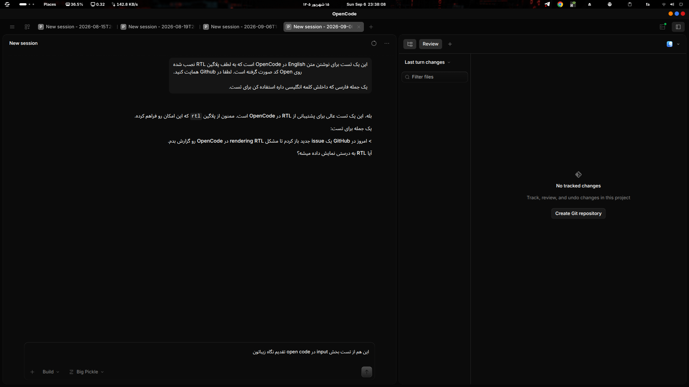

<div dir="rtl" lang="ar" align="center">

# 🇸🇦 OpenCode RTL Fix

**إضافة ثنائية الاتجاه (RTL/LTR) لأوبن‌كود** — إصلاح عرض النصوص المختلطة بين العربية/الفارسية/العبرية والإنجليزية في طرفية أوبن‌كود وسطح المكتب والواجهة الشبكية

[](LICENSE)
[]()
[](https://github.com/programmer-1998/RTL_OpenCode/actions/workflows/ci.yml)
[](https://www.npmjs.com/package/opencode-rtl-fix)
[](https://github.com/programmer-1998/RTL_OpenCode)

**اللغات:** [🇮🇷 فارسی](README.md) · [🇬🇧 English](README.en.md) · [🇸🇦 العربية](README.ar.md)

**👤 المنشئ:** [سينا خانزاده](https://sina-khanzadeh.ir) · المعرف: `programmer_1998` (ديسكورد / تيليجرام / إنستغرام) · البريد: khanzadeh.1377@gmail.com



</div>

<div dir="rtl" lang="ar">

## 📌 المشكلة

عندما تظهر كلمة إنجليزية أو معرّف داخل جملة عربية/فارسية — مثل `SINA` أو اسم ملف أو مسار أو اسم حزمة — تُخلط واجهة أوبن‌كود ترتيب الكلمات لأنها لا تطبّق خوارزمية ثنائية الاتجاه لليونيكود (**UAX #9**):

```
ما كتبته (الترتيب المنطقي):      سلام من SINA هستم
عرض معطّل:                       هستم SINA سلام من
العرض الصحيح (بصريًا):           هستم SINA من سلام    ← يُقرأ من اليمين إلى اليسار
```

تظهر هذه المشكلة في **الطرفية/TUI** و**تطبيق سطح المكتب** و**الواجهة الشبكية**، أثناء الكتابة في حقل الإدخال وعند عرض الرسائل وردود النموذج.

## 🧠 الحل — طبقتان

يحل هذا المشروع المشكلة عبر **طبقتين متكاملتين**:

| الطبقة | الأداة | ماذا تُصلح |
| --- | --- | --- |
| **1) طبقة النص (خادم أوبن‌كود)** | إضافة `server` | رسائل المستخدم المُرسلة وسجل المحادثة وردود النموذج ومخرجات الأدوات — عبر **عزل ثنائي الاتجاه** (`RLI` / `LRI` / `PDI`) وفق UAX #9. منذ أوبن‌كود **1.18.31** يتعرّف العرض الطرفي/سطح المكتب على الاتجاه تلقائيًا (`dir="auto"` + plaintext)، لذا تركز هذه الطبقة على الطرفية/الويب والحفاظ على ترميزات LTR |
| **2) طبقة الواجهة (سطح المكتب)** | رقعة `app.asar` (المحرك `patch/lib/patch-asar.mjs` + غلاف لكل نظام تشغيل)، وتطبّقها الإضافة نفسها وتُصلحها ذاتيًا | **كل أسطح النص في الواجهة**: حقل الكتابة المباشر، رسائل الدردشة، عناوين التبويبات/الجلسات والطرفية، القوائم، الحوارات، التنبيهات، الإعدادات، شجرة الملفات، أسماء ملفات المراجعة، المرفقات، الأذونات والأسئلة — عبر حقن `dir="auto"` + `unicode-bidi: plaintext` داخل `app.asar` (الكود والفروق ومخرجات الشل تبقى LTR) — إضافةً إلى خط **Vazirmatn** لكل نص الواجهة |

<details>
<summary>🔍 كيف يعمل؟</summary>

- **الإضافة** ترتبط بخطافات خادم أوبن‌كود (`chat.message`، `experimental.text.complete`، `tool.execute.after`، …). لكل فقرة تُحدد الاتجاه بقاعدة «أول حرف قوي»؛ الفقرات العربية/الفارسية تُغلَّف بـ `RLI…PDI`، والكلمات/الأكواد الإنجليزية داخلها (مثل `SINA` أو `/path/to/file`) تُعزل بـ `LRI…PDI` حتى لا ينقلب ترتيبها. هذه المحارف التحكمية غير المرئية قد تربك عارضَي الخلية-بخلية الساذجين وتلوّث المخزن الذي يصل للنموذج (مثل ضجيج `^`)، لذا فهذا العزل **اختياري** عبر `inlineControls: true`. افتراضيًا لا تحقن الإضافة أي محرف تحكم وتقوم أيضًا **بحذف** أي محارف اتجاه ملتصقة بالنص.
- **رقع سطح المكتب** تُضيف `<style>` و `<script>` إلى `out/renderer/index.html` داخل `app.asar`. وبما أن أوبن‌كود من **1.18.31** يُصلح الرسائل والردود تلقائيًا، تستهدف الرقعة ما زال مفقودًا: حقل الكتابة المباشر (`[data-component="prompt-input"]` و `[data-component="prompt-input-v2"]`) وعناوين التبويبات (`[data-slot="tab-title"]` و `[data-slot="terminal-tab-title"]`).

</details>

## ✨ المميزات

- ✅ عرض صحيح للفقرات المختلطة العربية/الفارسية/العبرية/الأردية + الإنجليزية
- ✅ عزل الكلمات والمعرّفات الإنجليزية داخل النص العربي (`SINA`، `API`، المسارات)
- ✅ حماية كاملة للـ**كود** — كتل الخلفيات الثلاثية، الأكواد المزاحة و`inline code` تبقى كما هي
- ✅ تصحيح الرسائل السابقة (سجل المحادثة) عند تحميلها
- ✅ اكتشاف تلقائي للاتجاه (أول حرف قوي) + إمكانية فرض `rtl`/`ltr`
- ✅ إرشاد اختياري للنظام حتى يجيب النموذج بلغتك ويُبقي الكود/المسارات LTR
- ✅ متغيرات بيئة اختيارية `OPENCODE_RTL*` للأدوات
- ✅ أمران لحالة TUI: `RTL: Show Status` و `RTL: Analyze Sample` (يعملان في v2 أيضًا عبر CLI API الجديد)
- ✅ رقعة سطح المكتب لأنظمة التشغيل الثلاثة (لينكس / ماك / ويندوز) مع نسخة احتياطية تلقائية وتحقّق من تخطيط `app.asar.unpacked` وإمكانية التراجع (`--unpatch`)
- ✅ تغطية كاملة لواجهة سطح المكتب: الدردشة والمحرر، تبويبات الجلسات والطرفية، القوائم، الحوارات، التنبيهات، الإعدادات، شجرة الملفات وعارض الملفات، لوحة المراجعة، المرفقات، الأذونات والأسئلة — مع حماية LTR للكود والفروق ومخرجات الشل
- ✅ خط **Vazirmatn (OFL)** مُضمَّن في واجهة سطح المكتب (دون تثبيت أي خط على النظام)
- ✅ **إصلاح ذاتي**: إضافة الخادم تطبّق رقعة سطح المكتب تلقائيًا وتُعيد تطبيقها بعد كل تحديث (دون تشغيل يدوي)
- ✅ متوافق مع أوبن‌كود **1.19.0** و **2.x** (مدخل `./v2` للخادم و `./v2/tui` للـCLI)

## ⚠️ قيد مهم (بصراحة)

**حقل كتابة البرومبت أثناء الكتابة الفعلية قبل الإرسال يُرسم بواجهة أوبن‌كود نفسها ولا يصل إليه أي خطاف إضافة.** لذلك:

- **تطبيق سطح المكتب** → يُصلح هذا الجزء رقعة `app.asar` (المحرك `patch/lib/patch-asar.mjs` مع غلاف لكل نظام تشغيل). لا تصل أي إضافة/امتداد إلى واجهة سطح المكتب، لذا تطبّق إضافة الخادم هذه الرقعة بنفسها و**تُصلحها ذاتيًا** — اضبط `desktop: false` إن كنت تفضّل الترقيع يدويًا.
- **الطرفية/TUI** → يُرسم خليةً بخلية عبر `@opentui/core`، والحل النهائي له يرجع إلى أوبن‌كود نفسه؛ لكن فور إرسال الرسالة، يُصلح برومبتك ورد النموذج عبر الطبقة ١ في كل مكان.

---

## 🚀 التثبيت والتفعيل في أوبن‌كود

أوبن‌كود يحمّل الإضافات **عند بدء التشغيل فقط**. بعد أي تغيير في الإعداد، أغلق أوبن‌كود وأعد فتحه.

### الخيار ١ — من npm (بعد النشر)

```jsonc
// ~/.config/opencode/opencode.jsonc  (عام)
// أو opencode.jsonc في جذر مشروعك (محلي)
{
  "$schema": "https://opencode.ai/config.json",
  "plugin": [
    [
      "opencode-rtl-fix",
      { "language": "auto" }
    ]
  ]
}
```

### الخيار ٢ — من المصدر / مسار محلي

```sh
git clone git@github.com:programmer-1998/RTL_OpenCode.git
cd RTL_OpenCode
npm ci && npm run build
```

ثم أشر إلى المجلد (أو إلى `dist/server.js`) في الإعداد:

```jsonc
{
  "$schema": "https://opencode.ai/config.json",
  "plugin": [
    [
      "/home/<user>/RTL_OpenCode",
      { "language": "auto", "isolateToolOutput": "off" }
    ]
  ]
}
```

> 💡 بدل المسار المطلق يمكنك استخدام `./RTL_OpenCode` (نسبةً إلى مجلد الإعداد) أو `file:///...` — كل النماذج الثلاثة صالحة.

### الخيار ٣ — اكتشاف تلقائي داخل المشروع

ضع الإضافة داخل أحد هذين المجلدين المحليين وسيجدها أوبن‌كود دون إعداد:

```
.opencode/plugin/rtl/package.json
.opencode/plugin/rtl/dist/…
```

### الخيار ٤ — أوبن‌كود ٢ (v2)

في v2 تغيّر مفتاح `plugin` إلى `plugins`، وتُضبط إضافة الطرفية separately في `cli.json`:

```jsonc
// opencode.jsonc
{
  "$schema": "https://opencode.ai/config.json",
  "plugins": [
    { "package": "opencode-rtl-fix", "options": { "language": "auto" } }
  ]
}
```

```jsonc
// cli.json (لأوامر RTL في الطرفية)
{
  "plugins": ["opencode-rtl-fix"]
}
```

هذه الحزمة تدعم الواجهتين: مدخل `./v2` لخادم v2 ومدخل `./v2/tui` لأوامر CLI.

> 💡 الطبقة ١ (إضافة الخادم المكتوبة بجافاسكربت) تعمل على **لينكس وماك وويندوز بشكل متطابق تمامًا**. فقط رقعة سطح المكتب (الطبقة ٢) لها ملف منفصل لكل نظام تشغيل — انظر أدناه.

---

## ⚙️ خيارات الإضافة

| الخيار | الافتراضي | الوصف |
| --- | --- | --- |
| `enabled` | `true` | تشغيل/إيقاف الكل |
| `language` | `"auto"` | `auto` أو `none` أو `fa` / `ar` / `he` / `ur` (فرض لغة) |
| `systemGuidance` | `true` | إضافة إرشاد RTL إلى برومبت النظام (أو نص مخصص) |
| `isolateUserMessages` | `"auto"` | `off` / `auto` / `always` — عزل رسائل المستخدم |
| `isolateAssistantText` | `"auto"` | عزل ردود النموذج |
| `isolateToolOutput` | `"off"` | عزل مخرجات الأدوات (أبقِه `off` إن كانت النسخ/اللصق الدقيق مهمًا) |
| `inlineControls` | `false` | عدم حقن محارف تحكم Unicode غير مرئية (`RLI`/`LRI`/`PDI`) في النص. في الوضع الافتراضي تحذف الإضافة أيضًا **محارف الاتجاه** الملتصقة بالنص (مثل LRM/RLM المنقولة من الويب) ليبقى المخزن الطرفي وسياق النموذج نظيفين — ويمنع ذلك ضجيج العرض `^`. اضبط `true` للعزل اليدوي |
| `minRtlRatio` | `0.2` | أقل نسبة أحرف RTL للاكتشاف التلقائي |
| `minRtlCharacters` | `2` | أقل عدد أحرف RTL |
| `digitMode` | `"preserve"` | تحويل الأرقام: `preserve` / `latin` / `arabic-indic` / `eastern-arabic` |
| `forceDirection` | `"auto"` | فرض اتجاه العزل: `auto` / `rtl` / `ltr` |
| `alignRtlParagraphs` | `false` | محاذاة يمين بصرية في الطرفية عبر padding **(يغيّر النص الخام أيضًا؛ TUI فقط)** |
| `rtlWrapColumn` | `96` | عمود الالتفاف المستخدم في المحاذاة |
| `rtlAlignColumn` | `96` | عمود المحاذاة اليمنى |
| `directionEnv` | `true` | تصدير `OPENCODE_RTL*` في بيئة الأدوات |
| `desktop` | `true` | تثبيت/إصلاح رقعة سطح المكتب تلقائيًا (`app.asar` + خط Vazirmatn). لجعل الإضافة لا تلمس ملفات التطبيق: `false` |
| `debug` | `false` | تسجيل عبر `client.app.log()` |

> **ملاحظة الاتجاه:** الاتجاه بحسب «أول حرف قوي»؛ جملة تبدأ بالعربية تصبح RTL، وجملة تبدأ بالإنجليزية/كود تصبح LTR. لفرض RTL دائمًا: `"forceDirection": "rtl"`.

---

## 🔧 استكشاف الأخطاء: ضجيج `^` في العرض بالطرفية

إذا رأيت محارف إضافية مثل `^^^^^` أثناء عرض النص العربي في TUI، فالسبب **محارف Unicode غير مرئية** — عوازل الاتجاه (`U+2066`/`U+2067`/`U+2069`) أو LRM/RLM الملتصقة بنص منسوخ من الويب — لا يحسبها عارض الخلية-بخلية بدقة. دور هذه الإضافة:

- منذ هذا الإصدار، لا تُحقن محارف التحكم افتراضيًا ويتم **حذف** أي محارف اتجاه موجودة في النص الجاري (`inlineControls: false`).
- إذا ضبطت `inlineControls: true` ورأيت ضجيجًا، أعدها إلى `false`.
- الجلسات القديمة المنشأة بإصدارات سابقة قد تحمل هذه المحارف في نصها المخزّن؛ ابدأ جلسة جديدة.

---

## 🖥️ رقعة تطبيق سطح المكتب (تغطية كاملة للواجهة)

يُرسم تطبيق Electron أجزاءً من النص دون أي اتجاه تلقائي. تُضيف الرقعة `<style>` + `<script>` إلى `out/renderer/index.html` داخل `app.asar` لتعمل **كل أسطح النص** — الدردشة والمحرر، التبويبات، القوائم، الحوارات، التنبيهات، الإعدادات، شجرة الملفات وعارضها، لوحة المراجعة، المرفقات، الأذونات والأسئلة — تمامًا كما في المتصفحات الحديثة (الكود والفروق ومخرجات الشل تبقى LTR عمدًا). كما تُضمّن الرقعة خط **Vazirmatn** بصيغة base64 وتضبط `--font-family-sans` ليصبح خط الواجهة كلها Vazirmatn، دون تثبيت أي خط على النظام ودون إنترنت.

> 🔁 **مهم:** منذ الإصدار **0.2.0** تطبّق إضافة الخادم هذه الرقعة و**تُصلحها ذاتيًا**؛ أي بعد كل تحديث لسطح المكتب (يستبدل `app.asar`) تُعيد الإضافة تطبيقها تلقائيًا. السكربتات اليدوية أدناه مطلوبة فقط إذا ضبطت `desktop: false` أو أردت التطبيق فورًا دون إعادة تشغيل.

تستند الرقعة إلى **محرك جافاسكربت مشترك** (`patch/lib/patch-asar.mjs`) يعمل بنفس الطريقة على أنظمة التشغيل الثلاثة؛ وكل «غلاف» خاص بنظام تشغيل يحدد مسار التطبيق ويأخذ الصلاحيات المطلوبة (sudo / UAC):

| نظام التشغيل | ملف التثبيت | المتطلبات |
| --- | --- | --- |
| 🐧 لينكس | `patch/linux/desktop-rtl.sh` | node 20+ و sudo |
| 🍎 ماك | `patch/macos/desktop-rtl.sh` | node 20+ و sudo |
| 🪟 ويندوز | `patch/windows/desktop-rtl.ps1` | node 20+ |

### التثبيت على لينكس

```sh
sudo bash patch/linux/desktop-rtl.sh
```

### التثبيت على ماك

```sh
sudo bash patch/macos/desktop-rtl.sh
```

> 💡 إذا رفض التطبيق الفتح بعد الرقعة (توقيع الكود)، أعِد التوقيع:
> `sudo codesign --force --deep --sign - "/Applications/OpenCode.app"`

### التثبيت على ويندوز

افتح PowerShell وشغّل:

```powershell
powershell -ExecutionPolicy Bypass -File patch\windows\desktop-rtl.ps1
```

وافق على نافذة UAC. (أو انقر نقرًا مزدوجًا على `patch\windows\desktop-rtl.cmd`.)

### ماذا يفعل

1. ينشئ نسخة احتياطية من `app.asar` في مكانها (`app.asar.bak-rtl`)؛
2. يستخرج الأرشيف ويُرقع `index.html` (قواعد الاتجاه + `@font-face` لخط Vazirmatn) ويعيد التعبئة؛
3. **يتحقق من تخطيط `app.asar.unpacked` (الوحدات الأصلية مثل `node-pty`) واحدًا تلو الآخر مقابل النسخة السابقة** حتى لا ينكسر شيء؛
4. يكتب ختمًا (`app.asar.rtl-stamp`) يحمل إصدار الرقعة؛ تستخدمه الإضافة لمعرفة ما إذا كانت الرقعة حديثة ولـ**ترقية** الرقع القديمة (دون ترقيع ملف مُرقَّع مرتين).

ثم **أغلق وأعد فتح تطبيق أوبن‌كود لسطح المكتب**.

### التراجع

```sh
# لينكس / ماك
sudo bash patch/linux/desktop-rtl.sh --unpatch
sudo bash patch/macos/desktop-rtl.sh --unpatch
```

```powershell
# ويندوز
powershell -ExecutionPolicy Bypass -File patch\windows\desktop-rtl.ps1 -Unpatch
```

### 🔁 إصلاح ذاتي بعد كل تحديث (افتراضي)

التطبيق يتحدّث تلقائيًا والتحديث يستبدل الملف المُرقَّع. منذ الإصدار **0.2.0** لا حاجة لأي خطوة يدوية:

- إضافة الخادم (التي تعمل مع سطح المكتب/CLI) تتحقق عند التحميل من وجود الرقعة وحداثتها؛
- `app.asar` مقفل أثناء تشغيل التطبيق، لذا تفحص الإضافة أولًا قابلية الكتابة ولا تُرقّع إلا عندما يكون التطبيق مغلقًا، وتعيد المحاولة كل دقيقتين؛
- لذا: ثبّت الإضافة → أغلق تطبيق سطح المكتب → في التشغيل التالي يكون مُرقَّعًا. وبعد كل تحديث يُصلح نفسه بالطريقة نفسها.

> لا تريد أن تلمس الإضافة ملفات التطبيق؟ اضبط `"desktop": false` واستخدم السكربتات اليدوية. لا شيء من هذا يحتاج `sudo`/UAC إلا إذا كان التطبيق مثبتًا في مسار نظامي.

### التثبيت اليدوي (اختياري)

> المسارات الافتراضية: لينكس `/opt/OpenCode/resources/app.asar`، ماك `/Applications/OpenCode.app/Contents/Resources/app.asar`، ويندوز `%LOCALAPPDATA%\Programs\OpenCode\resources\app.asar`. إذا كان مثبتًا في مكان آخر: لينكس/ماك `sudo DESKTOP_ASAR=/path/to/app.asar bash patch/<linux|macos>/desktop-rtl.sh`، ويندوز `powershell ... -Asar C:\path\to\app.asar`.

---

## 🧪 الاختبار في أوبن‌كود (خطوة بخطوة)

1. أغلق أوبن‌كود وأعد فتحه (ليتم تحميل الإضافة).
2. في **سطح المكتب**، اكتب هذا النص في حقل الكتابة — يجب أن يُقرأ طبيعيًا من اليمين إلى اليسار مع `SINA` في مكانه الصحيح:

   ```
   سلام من SINA هستم
   ```

3. أرسل برومبت مختلطًا يحتوي مسارًا/كودًا، مثل:

   ```
   محتوای فایل src/config.ts را بخوان و لیست بده
   ```

   وتحقّق من عدم انقلاب ترتيب `src/config.ts` مع الجملة الفارسية.
4. في **الطرفية**، إن كان لديك الأمر، تحقق من حالة الإضافة:

   ```
   /rtl.status
   ```

5. شغّل الاختبارات الآلية:

   ```sh
   cd RTL_OpenCode && npm test
   ```

---

## 🛠️ التطوير

```sh
npm ci
npm run build      # tsc → dist/
npm run typecheck
npm test           # البناء + الاختبارات (بما فيه محرك الرقعة)
```

## 📂 البنية

```
RTL_OpenCode/
├── src/
│   ├── core.ts      ← محرك Bidi: اكتشاف الاتجاه، العزل، ماركداون/كود، المحاذاة
│   ├── desktop.ts   ← حارس الإصلاح الذاتي لرقعة سطح المكتب (تطبيق/إصلاح app.asar)
│   ├── server.ts    ← خطافات الخادم v1 (1.19)
│   ├── tui.ts       ← أوامر TUI في v1
│   └── index.ts     ← الصادرات
├── plugin-v2.ts     ← إضافة الخادم v2 (أوبن‌كود ٢، `./v2`)
├── tui-v2.ts        ← إضافة CLI في v2 (أوامر RTL، `./v2/tui`)
│   └── index.ts     ← المخرجات
├── test/core.test.js   ← الاختبارات
├── patch/
│   ├── lib/patch-asar.mjs      ← محرك الرقعة المشترك (جافاسكربت، كل الأنظمة) + حارس الإصلاح الذاتي
│   ├── fonts/Vazirmatn-Variable.woff2 ← خط Vazirmatn (OFL) المُضمَّن كـbase64
│   ├── linux/desktop-rtl.sh    ← رقعة سطح المكتب للينكس
│   ├── macos/desktop-rtl.sh    ← رقعة سطح المكتب لماك
│   └── windows/
│       ├── desktop-rtl.ps1     ← رقعة سطح المكتب لويندوز
│       └── desktop-rtl.cmd     ← مشغّل النقر المزدوج لويندوز
├── examples/opencode.json ← نموذج إعداد كامل
└── dist/             ← ناتج البناء (مُرفَع)
```

## 🤖 CI والنشر (GitHub Actions)

- **`.github/workflows/ci.yml`** — عند push/PR: تثبيت، typecheck، بناء، اختبار على Node 20/22/24 + التحقق من تطابق `dist` مع المصدر + اختبارات نحوية ومحرك الرقعة لأنظمة التشغيل الثلاثة.
- **`.github/workflows/release.yml`** — عند رفع وسم `v*`:
  - يُنشئ **Release** على GitHub مع حزمة (zip) + `npm pack` (.tgz)؛
  - إذا كان سر `NPM_TOKEN` مضبوطًا يُنشر تلقائيًا على **npm** (`opencode-rtl-fix`).

  إنشاء نسخة:

  ```sh
  git tag v0.1.0 && git push origin v0.1.0
  ```

---

## 👤 المنشئ

هذا المشروع من إنشاء **سينا خانزاده**.

- 🌐 الموقع الشخصي: [sina-khanzadeh.ir](https://sina-khanzadeh.ir)
- 📧 البريد: [khanzadeh.1377@gmail.com](mailto:khanzadeh.1377@gmail.com)
- 🆔 معرف موحّد على مواقع التواصل: `programmer_1998` (ديسكورد · تيليجرام · إنستغرام)
- 📦 جيت‌هاب: [programmer-1998/RTL_OpenCode](https://github.com/programmer-1998/RTL_OpenCode)

## 🙏 الشكر والإسناد

- **أوبن‌كود** — [github.com/anomalyco/opencode](https://github.com/anomalyco/opencode) · [opencode.ai](https://opencode.ai)
- خط **Vazirmatn** — من إنشاء صابر راستي‌كردار، بترخيص [SIL OFL 1.1](https://github.com/rastikerdar/vazirmatn/blob/master/OFL.txt)
- إضافة **opencode-rtl** على npm (المؤلِّف: `razavioo`) التي كانت مصدر إلهام هذا التنفيذ
- عناصر ذات صلة في مستودع أوبن‌كود:
  - [issue #35319](https://github.com/anomalyco/opencode/issues/35319) — نص مختلط معطّل في سطح المكتب
  - [issue #32984](https://github.com/anomalyco/opencode/issues/32984) — عرض RTL في الواجهات
  - [issue #40286](https://github.com/anomalyco/opencode/issues/40286) — RTL/Bidi في TUI
  - [PR #25455](https://github.com/anomalyco/opencode/pull/25455) — `dir="auto"` للويب

## 📄 الترخيص

[MIT](LICENSE) © سينا خانزاده — sina-khanzadeh.ir · khanzadeh.1377@gmail.com

</div>